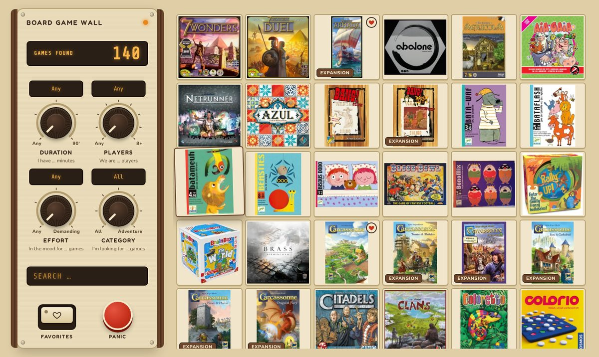
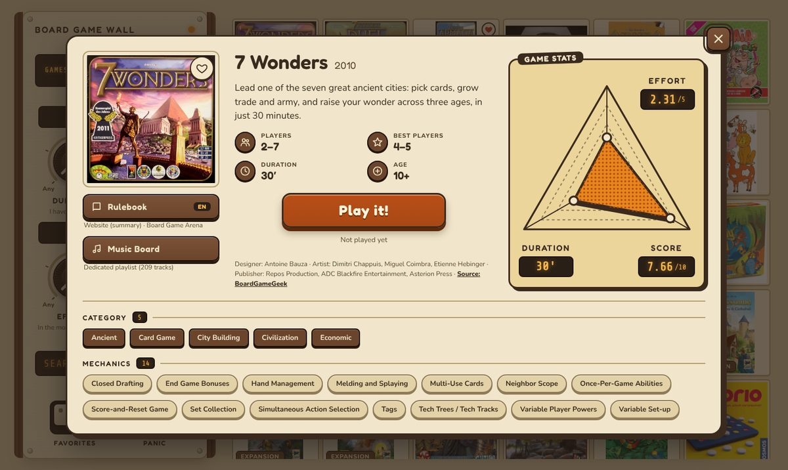
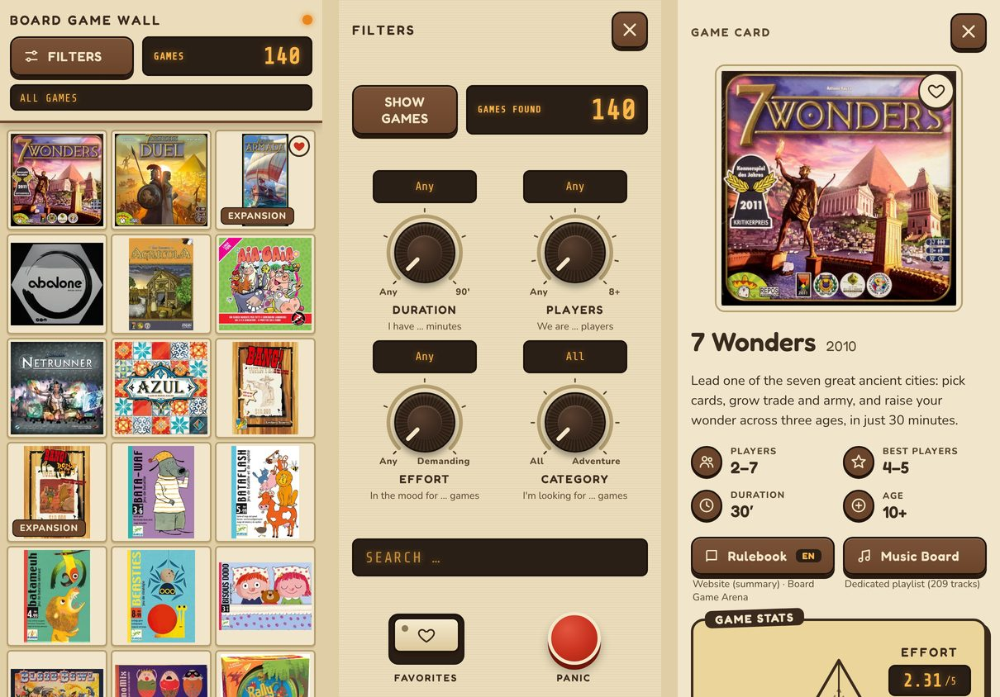

# Board Game Wall from photos

Create a responsive catalog of your own board game collection, simply by photographing your games on their shelves.

From a slightly geeky board game lover to board game lovers: an open, free project, built with free tools.

**Live example:** https://board-game-catalog.fflaminio.workers.dev



## What you get

- **A colorful wall of your own games**: every game is a tile on a vertical wall. It works on desktop and mobile.
- **Analog vintage filters**: pick the right game for any occasion, easily and with a bit of fun:
  - four knobs: Duration, Players, Effort, Category;
  - a keyword search;
  - a game counter and a PANIC button that resets everything.
- **A detailed card for every game** with everything you need to know:
  - description, players, duration and age;
  - a stats chart (effort, score, duration);
  - rulebook and music links;
  - category and mechanic chips with short definitions;
  - credit to BoardGameGeek (thanks, BGG!).
- **Owner features**:
  - mark your favorites;
  - keep a play log with "Play it!": number of plays, share of all plays, last play.
  - Everyone can see them; only you can change them, with your password.
- **Free to host**: GitHub and Cloudflare free plans, no server to manage. The AI assistant that reads your photos may have its own plan limits.





## Contents

- [How it works](#how-it-works)
- [Make your own catalog](#make-your-own-catalog)
  - [Step 1. Photograph your games](#step-1-photograph-your-games)
  - [Step 2. Create three free accounts](#step-2-create-three-free-accounts)
  - [Step 3. Put the demo site online: choose A or B](#step-3-put-the-demo-site-online-choose-a-or-b)
    - [Option A. Automatic: fewer steps, for beginners](#option-a-automatic-fewer-steps-for-beginners)
    - [Option B. Manual: more steps, more control](#option-b-manual-more-steps-more-control)
  - [Step 4. Turn your photos into your catalog](#step-4-turn-your-photos-into-your-catalog)
  - [Step 5. Upload your catalog](#step-5-upload-your-catalog)
- [Keep your catalog up to date](#keep-your-catalog-up-to-date)
- [Troubleshooting](#troubleshooting)
- [For developers](#for-developers)
- [Data, images and credits](#data-images-and-credits)
- [License](#license)

## How it works

```
Your photos ──(AI assistant + skill)──> Excel file + cover images
                                                │ upload to GitHub
                                                ▼
                    GitHub repository ──> Cloudflare builds and publishes your site
                                                │
                    favorites and plays <──> Cloudflare database
```

- **Your catalog is one Excel file** with one row per game, plus one cover image per game.
- **An AI assistant writes them for you.** It reads your photos, looks up each game on BoardGameGeek and follows the instructions in the included skill.
- **GitHub keeps your files.** Every time you change them there, Cloudflare checks the data and publishes the updated site in 1–2 minutes. If the data has an error, nothing is published and the previous version stays online.
- **Favorites and plays are saved in a small Cloudflare database.** Your password is stored as a Cloudflare secret, never in the code.

## Make your own catalog

**What you need:** a computer with a web browser, a phone or camera, about 30 minutes for the setup, plus the time the AI needs for your collection. No programming and no software to install.

**How it goes:**

1. Take the photos.
2. Create the accounts.
3. Put a demo site online, with the sample collection.
4. Let the AI build your catalog.
5. Upload it: your site now shows your games.

### Step 1. Photograph your games

- Use good, even light and avoid reflections on glossy boxes.
- Shoot each shelf straight on, with the titles on the box spines readable.
- Prefer several close photos to one wide photo: about 10–15 boxes per photo.
- Take a close-up of small boxes and of titles printed sideways or very small.

### Step 2. Create three free accounts

| Account | Where | What to do |
|---|---|---|
| GitHub | https://github.com/signup | Enter email, password and a username. The username is public and appears in your addresses. Confirm the code GitHub sends by email. |
| Cloudflare | https://dash.cloudflare.com/sign-up | Enter email and password and confirm your email. The free plan is enough and needs no credit card. |
| Claude | https://claude.ai | Sign up, open **Settings → Capabilities** and turn on **Code execution and file creation** (it may be called **Create and edit files**). Claude needs it to create the Excel file and the images. |

Another AI assistant can work too. It must read images, browse the web and create Excel and image files.

### Step 3. Put the demo site online: choose A or B

Both options give the same result: your own copy of the project on GitHub, connected to Cloudflare, with a site online showing the sample collection. In step 5 you replace it with your games.

#### Option A. Automatic: fewer steps, for beginners

1. Click this button:

   [](https://deploy.workers.cloudflare.com/?url=https://github.com/fflaminio/board-game-catalog)

2. Log in to Cloudflare when asked. The page **Set up your application** opens.
3. **Git account**: choose GitHub and allow Cloudflare to access it. Cloudflare creates a copy of the project in your GitHub account. You can tick **Create private Git repository** to keep that copy private.
4. **Project name** (`board-game-catalog`) and **D1 database** (`board-game-db`, new): keep them or change them as you like. The project name becomes part of your site address.
5. **ADMIN_PASSWORD**: type your owner password (max 16 characters) and note it somewhere safe.
6. Leave **Build command** (`npm run build`), **Deploy command** (`npm run deploy`) and the other settings as they are, then click **Deploy**.
7. Wait 2–3 minutes. Cloudflare shows the address of your site, ending in `.workers.dev`. Open it: you see the demo collection.

Cloudflare has created everything: the copy of the project on GitHub, the database with its tables, the password and automatic publishing. Go to [step 4](#step-4-turn-your-photos-into-your-catalog).

#### Option B. Manual: more steps, more control

**B1. Copy the project to your GitHub**

1. Open https://github.com/fflaminio/board-game-catalog
2. Click **Fork**, then **Create fork**. You now have your own copy, called your *repository*.

**B2. Create the database**

1. In Cloudflare, open **Storage & databases → D1 SQLite Database → Create**.
2. Name it `board-game-db` and confirm.
3. Open its **Console** tab.
4. In your repository, open `migrations/0001_init.sql` and copy all its text.
5. Paste the text in the Console and run it. This creates the tables.
6. Copy the **Database ID** shown on the database page.

**B3. Point the project to your database**

1. In your repository, open `wrangler.jsonc` and click the pencil icon (**Edit**).
2. Replace the value of `database_id` with your Database ID, keeping the quotes.
3. Click **Commit changes**.

**B4. Publish the site**

1. In Cloudflare, open **Workers & Pages → Create application** and choose **Import a repository**.
2. Connect GitHub when asked and select your repository.
3. Fill in the settings:
   - **Project name**: `board-game-catalog`. It must match `name` in `wrangler.jsonc`.
   - **Build command**: `npm run build`.
   - **Deploy command**: `npx wrangler deploy`.
4. Click the deploy button.
5. Wait 1–2 minutes. If Cloudflare asks you to choose a `workers.dev` subdomain, pick any name: it becomes part of your site address.

**B5. Set the owner password**

1. In Cloudflare, open your Worker → **Settings → Variables and Secrets → Add**.
2. Name it `ADMIN_PASSWORD` and enter your password (max 16 characters).
3. Tick **Secret**, so the value is encrypted and never shown again.
4. Click the deploy button.

**B6. Check:** open your Worker's address, ending in `.workers.dev`. You see the demo collection.

### Step 4. Turn your photos into your catalog

**Get the files:** on your repository page on GitHub, click **Code → Download ZIP** and unzip it on your computer. You need two things from it:

- the folder `skills/board-game-catalog-from-photos`;
- the sample catalog `data/Giochi_in_scatola_FINALE.xlsx`, which Claude uses as a template.

**Add the skill to Claude:**

1. Compress the folder `board-game-catalog-from-photos` into a ZIP file.
2. In Claude open **Customize → Skills**, click **+**, then **Create skill → Upload a skill**, and choose the ZIP.

If your plan does not allow custom skills, or you use another assistant, open the file `SKILL.md` instead and paste its text at the start of the chat.

**Build the catalog:**

1. Start a new chat.
2. Attach your photos and the sample Excel file. With many photos, send them in batches of about 10–20.
3. Write:

   > Use the board-game-catalog-from-photos skill. Build my catalog from these photos, replacing the sample games. Give me the Excel file and the cover images in ZIP files ready to upload to GitHub.

4. Claude lists the games it found and asks about the boxes it could not read. Answer and confirm the list.
5. Download the Excel file and the ZIP files with the images. Each ZIP holds at most 100 images, because GitHub accepts 100 files per upload.

A big collection is a long task: you can work one shelf at a time, asking Claude to add the new games to the same Excel file.

### Step 5. Upload your catalog

Do it in this order: remove the sample images, add yours, then the Excel file. Builds that start before the Excel file is uploaded may fail. That is normal: the site stays online.

1. **Remove the sample images:**
   - in your repository, open the folder `public/covers`;
   - click **…** at the top right, then **Delete directory**, then **Commit changes**.
2. **Add your images:**
   - unzip each image ZIP: inside you find a `public` folder;
   - on your repository's main page click **Add file → Upload files**;
   - drag that `public` folder onto the page and click **Commit changes**.
   - Repeat for every ZIP.
3. **Add the Excel file:**
   - open the folder `data`, then **Add file → Upload files**;
   - drag `Giochi_in_scatola_FINALE.xlsx` (same name: it replaces the sample) and click **Commit changes**.
4. **Check:**
   - in Cloudflare open your Worker → **Deployments**: after 1–2 minutes the latest one is successful;
   - open your site and refresh the page: your games are there.

## Keep your catalog up to date

- **Add a game:**
  - in Claude, attach your current Excel file and write: *Use the board-game-catalog-from-photos skill to add this game:* followed by its name, its BoardGameGeek link or a photo of the box;
  - upload the new cover, the new thumbnail and the Excel file as in step 5, without deleting anything.
- **Fix a detail**: edit the Excel file and upload it again to `data`. The rules for each column are in the skill.
- **Favorites and plays**: on your site, open a game. Tap the heart, or **Play it!** after a game night. The password is asked once per visit. **Undo** removes a play recorded by mistake within 10 seconds.
- **Change the password**:
  - in Cloudflare open your Worker → **Settings → Variables and Secrets**;
  - edit `ADMIN_PASSWORD` and deploy.

## Troubleshooting

| What you see | What to do |
|---|---|
| The site does not change after an upload | Open your Worker → **Deployments** → latest build → log. The log names the row, the game ID and the field to fix (messages are in Italian, for example *Copertina mancante* = cover missing). Fix the Excel file and upload it again. Then refresh the page with Ctrl+F5. |
| Build error about the database (option B) | `database_id` in `wrangler.jsonc` is still the original one: repeat B3. |
| Build error about the Worker name (option B) | The project name in Cloudflare must be `board-game-catalog`, as in `wrangler.jsonc`. |
| "The password is not set up yet" | The `ADMIN_PASSWORD` secret is missing: see B5. |
| The FAVORITES button, the hearts and "Play it!" do not appear | The database is not reachable or has no tables: check that `migrations/0001_init.sql` was run (B2). |
| "Too many attempts" | After 5 wrong passwords the site waits 15 minutes. |

## For developers

The site is plain HTML, CSS and JavaScript, with no framework. The build reads the Excel file with `exceljs`; the API is a Cloudflare Worker with a D1 database.

| Path | Content |
|---|---|
| `data/` | catalog Excel: sheet `Giochi` (one row per game) and sheet `Glossary` (definitions) |
| `public/` | website: `index.html`, `css/`, `js/`, `fonts/`, `covers/` and `covers/thumbs/` |
| `scripts/build-catalog.mjs` | Excel → `public/catalog.json`, with validation |
| `src/worker.js` | API: `/api/state`, `/api/login`, `/api/favorite`, `/api/play`, `/api/play/undo` |
| `migrations/` | D1 tables |
| `skills/board-game-catalog-from-photos/` | AI skill: photos → Excel, covers and thumbnails |
| `wrangler.jsonc`, `.dev.vars.example` | Cloudflare configuration; the password secret |

Run it locally with Node.js 20 or later:

```
npm install
npm run build
echo ADMIN_PASSWORD="choose-one" > .dev.vars
npx wrangler d1 migrations apply DB --local
npx wrangler dev
```

`npm run deploy` applies the database migrations and publishes the Worker.

## Data, images and credits

- **Game data**: most of it comes from [BoardGameGeek](https://boardgamegeek.com), whose terms allow non-commercial use with attribution. Every game card links to its BoardGameGeek page.
- **Cover images**: they belong to their publishers. The sample covers are included only as a demo: use covers of your own games.
- **Music**: links point to [Melodice](https://melodice.org) playlists.
- **Fonts**: Fredoka, Nunito and Share Tech Mono are under the SIL Open Font License (see `public/fonts/LICENSES.txt`).

## License

The code is released under the MIT License (see `LICENSE`). The license does not cover cover images, game data from BoardGameGeek or the fonts, which keep their own terms.

Made with the help of Claude (Anthropic).
